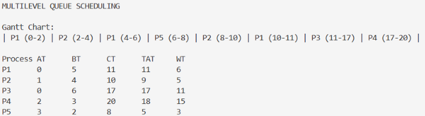
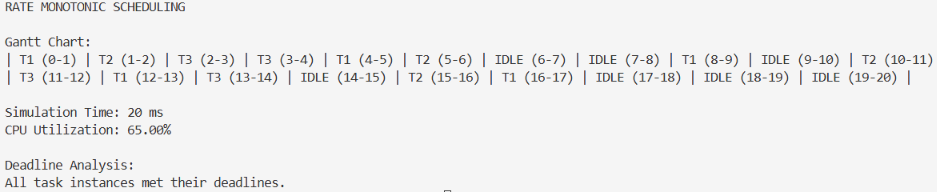
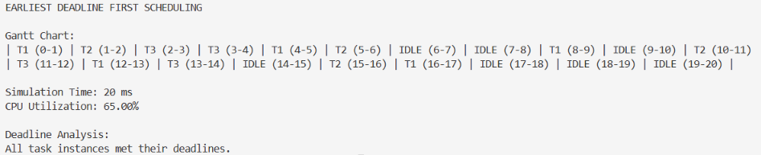

# OS Laboratory Activity 3

## Multilevel Queue and Real-Time CPU Scheduling

## Student Information

- **Name:** Candice S. Guinoo
- **Course and Section:** BS Computer Applications | B186
- **Instructor:** Maria Fe P. Bahinting
- **Date Submitted:** November 9, 2026

## I. Introduction

This activity focuses on implementing Multilevel Queue (MLQ), Rate Monotonic Scheduling (RMS), and Earliest Deadline First (EDF) using Python. These algorithms help manage processes and tasks based on their priorities and scheduling requirements.

## II. Objectives

- Implement Multilevel Queue Scheduling using Round Robin and FCFS.
- Implement Rate Monotonic Scheduling.
- Implement Earliest Deadline First Scheduling.
- Generate Gantt charts to show the execution order.
- Calculate CPU utilization and analyze deadline compliance.
- Use GitHub to manage and submit the project.

## III. Scheduling Algorithms

### 1. Multilevel Queue (MLQ)

MLQ separates processes into different queues based on their type. Queue 1 uses Round Robin with a time quantum of 2 ms, while Queue 2 uses First Come First Serve (FCFS).

Queue 1 has a higher priority than Queue 2.

### 2. Rate Monotonic Scheduling (RMS)

RMS is a fixed-priority scheduling algorithm. The task with the shorter period gets a higher priority.

### 3. Earliest Deadline First (EDF)

EDF is a dynamic-priority scheduling algorithm. The task with the earliest absolute deadline gets the CPU first.

## IV. Program Implementation

The project contains three Python programs:

- `multilevel_queue/mlq.py` – Implements Multilevel Queue Scheduling.
- `real_time_scheduling/rms.py` – Implements Rate Monotonic Scheduling.
- `real_time_scheduling/edf.py` – Implements Earliest Deadline First Scheduling.

The programs use Python to simulate scheduling and display Gantt charts and scheduling results.

## V. Test Data

### 1. MLQ Test Data

| Process | Arrival Time | Burst Time | Queue |
|---|---:|---:|---:|
| P1 | 0 | 5 | 1 |
| P2 | 1 | 4 | 1 |
| P3 | 0 | 6 | 2 |
| P4 | 2 | 3 | 2 |
| P5 | 3 | 2 | 1 |

- Queue 1: Round Robin, Quantum = 2 ms
- Queue 2: FCFS

### 2. RMS Test Data

| Task | Execution Time | Period | Deadline |
|---|---:|---:|---:|
| T1 | 1 ms | 4 ms | 4 ms |
| T2 | 1 ms | 5 ms | 5 ms |
| T3 | 2 ms | 10 ms | 10 ms |

Simulation Time: 20 ms

### 3. EDF Test Data

EDF uses the same task data as RMS.

Simulation Time: 20 ms

## VI. Results and Discussion

### 1. Multilevel Queue Results

**Gantt Chart:**
```text
P1 (0-2) | P2 (2-4) | P1 (4-6) | P5 (6-8) |
P2 (8-10) | P1 (10-11) | P3 (11-17) | P4 (17-20)
```

**Scheduling Results:**

| Process | CT | TAT | WT |
| ------- | -- | --- | -- |
| P1 | 11 | 11 | 6 |
| P2 | 10 | 9 | 5 |
| P3 | 17 | 17 | 11 |
| P4 | 20 | 18 | 15 |
| P5 | 8 | 5 | 3 |

Queue 1 processes were scheduled before Queue 2 processes because Queue 1 has a higher priority.

### 2. RMS Results

**Gantt Chart:**
```text
T1 (0-1) | T2 (1-2) | T3 (2-3) | T3 (3-4) |
T1 (4-5) | T2 (5-6) | IDLE (6-7) | IDLE (7-8) |
T1 (8-9) | IDLE (9-10) | T2 (10-11) | T3 (11-12) |
T1 (12-13) | T3 (13-14) | IDLE (14-15) | T2 (15-16) |
T1 (16-17) | IDLE (17-18) | IDLE (18-19) | IDLE (19-20)
```

**Scheduling Results:**
- Simulation Time: 20 ms
- CPU Utilization: 65.00%
- Deadline Analysis: All task instances met their deadlines.

The task with the shortest period was given the highest priority.

### 3. EDF Results

**Gantt Chart:**
```text
T1 (0-1) | T2 (1-2) | T3 (2-3) | T3 (3-4) |
T1 (4-5) | T2 (5-6) | IDLE (6-7) | IDLE (7-8) |
T1 (8-9) | IDLE (9-10) | T2 (10-11) | T3 (11-12) |
T1 (12-13) | T3 (13-14) | IDLE (14-15) | T2 (15-16) |
T1 (16-17) | IDLE (17-18) | IDLE (18-19) | IDLE (19-20)
```

**Scheduling Results:**
- Simulation Time: 20 ms
- CPU Utilization: 65.00%
- Deadline Analysis: All task instances met their deadlines.

The tasks were selected based on their earliest absolute deadlines.

### Execution Screenshots

**Multilevel Queue Scheduling**



**Rate Monotonic Scheduling**



**Earliest Deadline First Scheduling**



## VII. Algorithm Comparison

| Feature | MLQ | RMS | EDF |
|---|---|---|---|
| Priority Basis | Queue priority | Task period | Absolute deadline |
| Priority Type | Fixed queue priority | Fixed | Dynamic |
| Scheduling | Depends on queue policy | Preemptive | Preemptive |
| Main Purpose | Process classification | Periodic tasks | Deadline-based tasks |
| Deadline Monitoring | Not inherent | Yes | Yes |

## VIII. Guide Questions

**1. What is the difference between Multilevel Queue and Multilevel Feedback Queue Scheduling?**

- MLQ assigns processes to fixed queues, while MLFQ allows processes to move between queues based on their behavior and requirements.

**2. Why are different scheduling algorithms used in MLQ?**

- Different algorithms are used because processes have different needs. Interactive processes need faster responses, while batch processes can wait longer.

**3. How does RMS select the task to execute?**

- RMS selects the ready task with the shortest period because it has the highest priority.

**4. Why does RMS use fixed priorities?**

- RMS uses fixed priorities because each task's priority is based on its period, which does not change.

**5. How does EDF select the next task?**

- EDF selects the ready task with the earliest absolute deadline.

**6. Why does EDF use dynamic priorities?**

- EDF uses dynamic priorities because task priorities can change as their deadlines get closer.

**7. What happens if a newly released EDF task has an earlier deadline than the running task?**

- The newly released task can preempt the running task because it has an earlier deadline.

**8. Why is CPU utilization important in real-time scheduling?**

- CPU utilization shows how much of the processor's time is being used to execute tasks. It helps determine if the processor can handle the workload.

**9. Can a task set with less than 100% CPU utilization still miss a deadline? Explain.**

- Yes. A task can still miss its deadline because of scheduling limitations, task dependencies, or other system overhead.

**10. Which is better for periodic real-time tasks, RMS or EDF? Explain.**

- EDF can be better because it uses task deadlines to decide which task should run first. It can also handle higher CPU utilization under its scheduling assumptions.

## IX. Conclusion

This activity helped me understand how different CPU scheduling algorithms work. I was able to implement MLQ, RMS, and EDF using Python and generate their Gantt charts. I also learned how to calculate CPU utilization and check if tasks meet their deadlines. Overall, this activity helped me understand how scheduling algorithms manage processes and tasks in an operating system.
